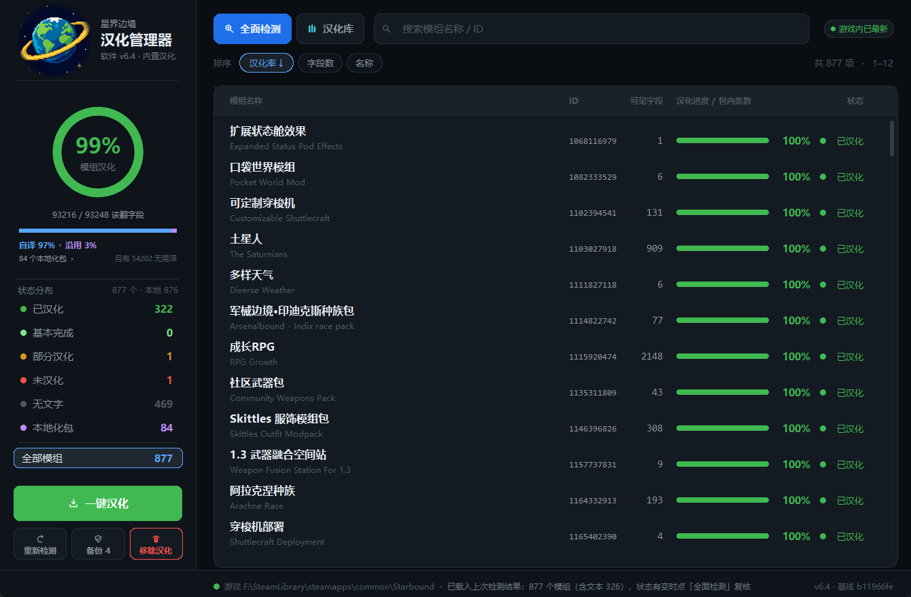
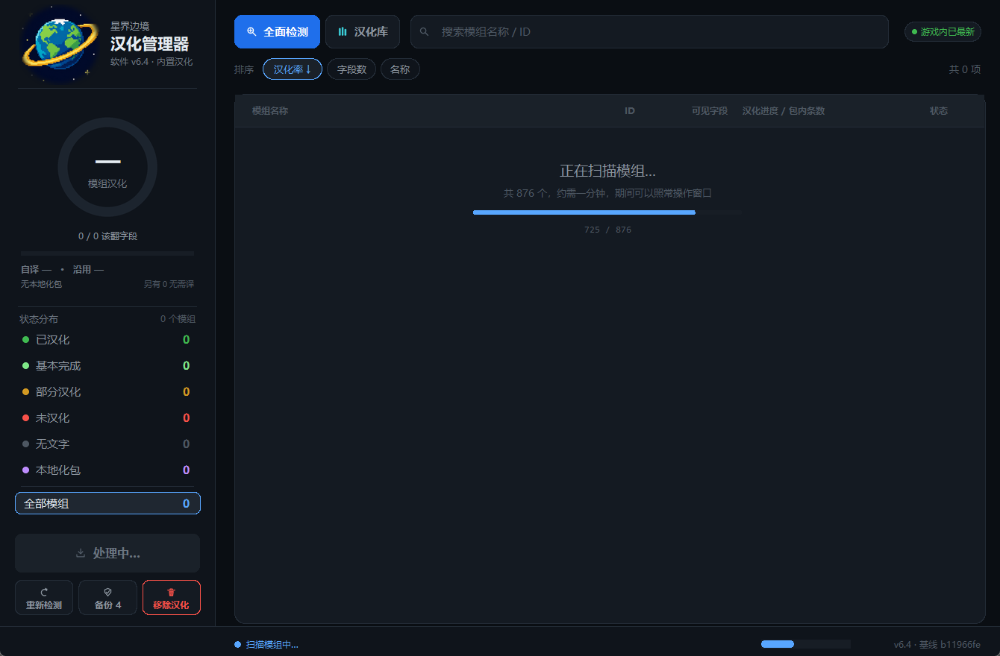

# 星界边境 汉化管理器

为《星界边境》(Starbound) 创意工坊的模组补上中文文本，并统一管理安装、回滚与版本。

本体自带官方中文，创意工坊的模组大多只有英文。这个工具做两件事：把汉化包写进游戏，以及在写进去之后管得住它。

---

## 现状

- 覆盖 **877 个模组**、**93,248 个该翻字段**，已翻 **93,216 个**，约 **99%**
- 剩余部分不是遗漏，是替换不到：模组运行时用代码拼接的句子、写死在脚本逻辑里的提示、图片内的文字
- 因此这里不写 100%，也不建议任何转载写成「完全汉化」

## 功能

- **一键汉化**：汉化包写入游戏 `mods` 目录，无需手动定位路径、逐个复制
- **一键还原**：撤除补丁并清理残留，游戏回到原文；撤销前自动备份
- **逐模组进度**：按模组列出已翻与剩余条目，状态用颜色区分
- **工坊直达**：点模组名直接跳转对应的创意工坊页面
- **汉化库**：已自带中文、或不需要翻译的模组可单独移出，只生成保留项的汉化包
- **自动备份**：每次写入前生成回滚点，装错可退回上一版本

## 下载

到 [Releases](../../releases) 页面下载 `Starbound_CN_Manager_v6.4.zip`。

| 校验项 | 值 |
|---|---|
| 文件大小 | 35,440,927 字节 |
| MD5 | `54a2a7dabbef9e941d486274e55a2504` |
| SHA-256 | `d790d8ef9d52cbd09bf0e93efc5614344df0d6702b713da582a5f5329d87f68c` |
| 内置汉化包指纹 | `b11966fe` |

## 使用

**方式一：用管理器（推荐）**

1. 解压到任意普通文件夹。**不要放在 `C:\Program Files`**，程序需要往自己目录写文件，那个位置需要管理员权限。
2. 双击 `星界边境汉化管理器.exe`。程序会自动读取 Steam 配置定位游戏路径，找不到时可手动选择。
3. 点「一键汉化」，等进度跑完，进入游戏即为中文。

**方式二：只要汉化包（不用 exe）**

不想运行可执行文件的话，在 Release 里单独下载 `CN_Full.pak`，放进 `Starbound/mods/` 目录，重启游戏即可。
删掉这个文件就是还原。这种方式没有逐模组进度、备份和汉化库。

## 常见问题

**第一次打开很慢？**
正在扫描已订阅的模组，订阅量较大时首次约需一分钟，底部有进度条。这不是卡死，之后每次启动只需几秒。

**杀毒软件报毒？**
PyInstaller 打包的通病，生成的 exe 结构与某些病毒壳相似，容易被误判，并非病毒。可上传 virustotal 自行核对，或加入白名单。软件不联网、不写注册表、不装服务。

**装完进游戏还是英文？**
最常见的原因是游戏没有重新启动——星界边境只在启动时读取 `mods` 目录。另外确认软件右上角状态标签显示「游戏内已更新」。

**支持哪些版本？**
按 1.4.4 制作，即 Steam 当前版本；874 个模组的合集实测通过。

## 版权与致谢

- 本工具只做文本汉化，输出的是文本补丁包，**不修改也不重新分发**任何原模组的贴图、模型与脚本
- 原模组仍需自行在创意工坊订阅；模组版权归各自原作者
- 汉化数据主要围绕「百年沃克绍，汉化有保障——主合集」（创意工坊 ID `1994669422`）收录的模组整理，感谢整理者
- 创意工坊上部分模组自带他人制作的汉化补丁，工具会将这类内容识别并单独标为「本地化包」，不计入本工具成果，也不收录进本工具发布的汉化包
- 本工具完全免费，无付费内容、无广告、无强制捐赠。**请勿在任何平台付费转售**

## 更新记录

**v6.4**（2026-11-25）
- 侧栏进度上限改为 99%，不再出现 100% 的表述
- 修复首次启动时的界面卡顿（扫描期间的目录枚举与重绘优化）
- 补全 118 个种族条目，官方 10 个种族文本完整
- 修正 2 处色标丢失与 1 处数值结构合并

---

## English

Starbound Chinese Localization Manager — a Windows tool that applies a Chinese text patch to Steam Workshop mods and manages install / rollback / per-mod progress.

- Covers 877 mods, 93,248 translatable fields, ~99% translated
- One-click install and one-click revert, with automatic backup before writing
- Portable (no installer), offline, no registry writes
- Requires Starbound 1.4.4 on Steam

Download from [Releases](../../releases). The UI is Chinese only; the patch only replaces display text and does not modify mod assets.
